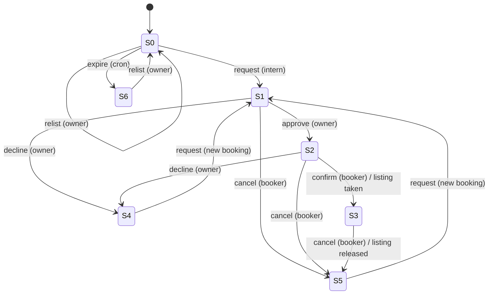

# FSM model: booking and listing lifecycle (FSM/BBT)

Owner: Jayden. Source of truth for the tests: `tests/course/models/bookingFsm.ts`.

## Source of the model

Built from the specification, not the code: contract section 13.4 (deterministic
booking state machine: requested -> approved -> booked, decline and cancel releases),
the README freshness rule ("stale or taken listings never surface") and the
one-live-hold rule. A state is the pair (latest booking status, listing status).

Mapping from the proposal's wording to the implemented vocabulary: "pending" =
`requested`, "confirmed" = `booked`, "listing taken" = listing status `taken`,
"relisted or expired" = listing `available` after a subletter confirm, or `stale` after
the daily freshness pass.

## States

| Id | Booking | Listing | Meaning |
| --- | --- | --- | --- |
| S0 | none | available | Listed, no live booking |
| S1 | requested | available | Intern requested, waiting on owner |
| S2 | approved | available | Owner approved, waiting on booker |
| S3 | booked | taken | Booker confirmed; listing leaves the deck |
| S4 | declined | available | Owner declined; listing free again |
| S5 | cancelled | available | Booker cancelled; listing free again |
| S6 | none | stale | Expired without reconfirmation |

## Diagram

## Test design

Three coverage criteria, run against two implementations of the same behavior:
the live API path (real route handlers over an in-memory Supabase fake) and the
fixture data source the app uses with no keys.

* Transition coverage: every valid transition T01-T13 at least once.
* Sneak paths: 18 invalid (state, event or actor) pairs I01-I18; each must be
  rejected (403 wrong actor, 409 wrong state) and leave state unchanged.
* Path coverage: 5 multi-event paths P01-P05 from S0, with the invariant "at most one
  live hold per listing" checked at the end.
* Concurrency: C01 two interns request at the same instant; C02 owner double-approves.

| Id | From | Event | Expected | Live API (round 1) | Fixture (round 1) |
| --- | --- | --- | --- | --- | --- |
| T01-T05, T09 | see diagram | | to-state | pass | pass |
| T06-T08 | S1/S2/S3 | cancel | S5 | pass (library only, no route: D07) | N/A (no fixture method: D07) |
| T10-T11, T13 | | | | pass | N/A (no fixture expiry) |
| T12 | S6 | relist | S0, 7-day window | pass | **fail: 14-day window (D06)** |
| I01, I14-I16 | | wrong actor | 403 | pass | N/A (single actor) |
| I02, I03, I06, I08, I17, I18 | | wrong state | 409, no change | pass | pass |
| I04, I05, I07 | S3/S3/S4 | approve/decline/approve | no change | pass | **fail (D03)** |
| I09, I10, I11 | S1/S2/S3 | second request | 409 | pass | **fail I09, I11 (D04)** |
| I12 | S6 | request | 409 | pass | **fail (D04)** |
| I13 | S3 | relist | 409 | **fail (D01)** | **fail (D05)** |
| P01-P05 | S0 | paths | end state, one live hold | pass | partly N/A |
| C01 | S0 | two requests at once | 201 + 409 | **fail: 201 + 500 (D02)** | N/A |
| C02 | S1 | double approve at once | 200 + 409 | pass | N/A |

Totals: live path 40 cases (38 pass, 2 fail in round 1); fixture 19 cases (11 pass,
8 fail). All pass in round 2.
