# FSM model: onboarding step sequence (FSM/BBT)

Owner: Jayden. Executed end to end in Chromium with Playwright against the app in
fixture mode: `tests/e2e/onboarding-fsm.e2e.mjs`.

## Model

```mermaid
stateDiagram-v2
  [*] --> O1
  O1 --> O2: use sample / upload PDF
  O2 --> O2: edit field (finance recomputes)
  O2 --> O3: continue [employer, role, start set; no unreviewed flags; end >= start]
  O3 --> O4: continue (account created, or visible demo fallback)
  O4 --> O5: connect Spotify / skip
  O5 --> O6: use sample Takeout + continue / skip
  O6 --> O7: continue / skip (initials)
  O7 --> O8: continue / "find my flock later" (optionally add friends first)
  O8 --> [*]
```

| Id | State | Screen marker |
| --- | --- | --- |
| O1 | Upload offer | "Upload your offer letter" |
| O2 | Review parsed fields | "Here's what we got" |
| O3 | Account assist | "Account created" or "No live account was created" |
| O4 | Spotify | "Connect Spotify" / "Skip for now" |
| O5 | Maps Takeout | "Maps Takeout" / "We found your usual spots" |
| O6 | Photo | "Put a face to your name" |
| O7 | Flock | "Find your flock" |
| O8 | Done | "You're set" |

The guard on O2 -> O3 is the interesting part: Continue must be enabled only when the
required fields are present, every low-confidence field has been reviewed, and the
dates are consistent.

## Test cases and results

| Id | Covers | Round 1 | Round 2 |
| --- | --- | --- | --- |
| OB-T01 | O1 -> O2 | pass | pass |
| OB-T02 | O2 guard false: flags outstanding | pass | pass |
| OB-T03 | O2 guard true after reviewing flags | pass | pass |
| OB-T04 | O2 -> O3, visible fallback (no silent identity swap) | pass | pass |
| OB-T05..T09 | skip path O3 -> O4 -> O5 -> O6 -> O7 -> O8 | pass | pass |
| OB-T10 | continue path, add a friend in O7, reach O8 | pass | pass |
| OB-T11 | guard: empty employer disables Continue | pass | pass |
| OB-T12 | guard: end date before start date | **fail (D08)** | pass |
| OB-T13 | O2 self-loop: salary edit recomputes take-home | pass | pass |
| OB-T14 | reload in O5 | observation: returns to O1 | same |

OB-T14 is recorded as an observation, not a defect: the specification does not say
whether onboarding progress survives a reload. It is listed as an open question for
the final report.
