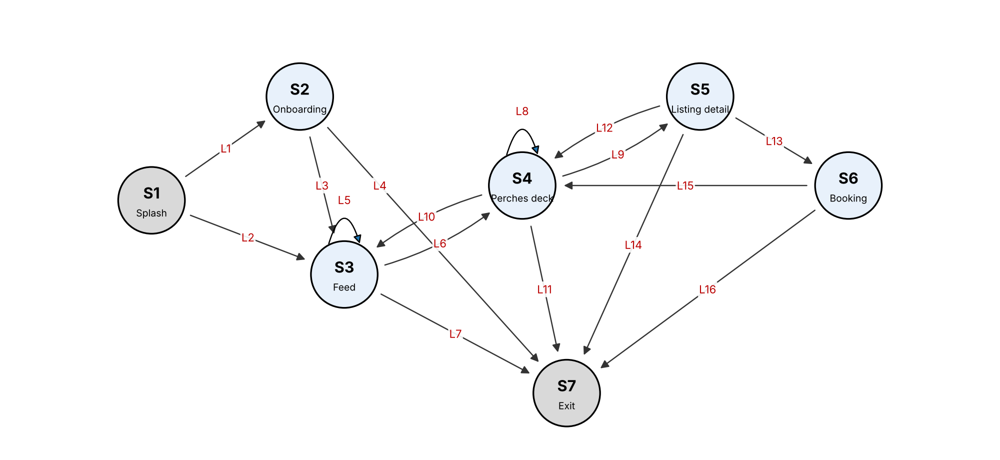

# Homework #3: FSM and Markov Operational Profile for Perch

Jayden Manyrath | CSE 5314, Fall 2026 | Prof. Jeff Tian | Homework #3 | November 3, 2026

## 1. FSM Model

I modeled Perch, the intern housing and social app from our course project, from a user's perspective. I focused on the housing flow: a user starts on the splash page, goes through onboarding or comes back as a returning user, browses the event feed, swipes through sublets on the Perches deck, opens a listing, and requests to book it. Each state is a screen and each link is a user action. Figure 1 shows the model, which has 7 states and 16 links, with S1 (Splash) as the start state and S7 (Exit) as the final state. It includes repetition. Opening more event comments (L5) and swiping to the next card (L8) are self-loops, and deck to listing and back (L9, L12) and deck to listing to booking and back (L9, L13, L15) are cycles that a user can repeat many times in one session.

## 2. Model Validation

I validated the first draft in two ways. First, a small script checked the model for dangling links, isolated and unreachable states, states with no way to reach Exit, and duplicate links. Second, I walked through the running app screen by screen to find missing states and links. Table 1 lists what I found and fixed. After the fixes, every state is reachable from Splash and can reach Exit, and there are no dangling or duplicate links.

| Problem in the first draft | Type | Fix |
| --- | --- | --- |
| "Close sheet" from Booking had no destination | Dangling link | Points to Perches deck (L15) |
| Booking had no way to Exit | Trap state | Added L16 |
| Deck to listing appeared twice ("tap card" and "tap Details") | Duplicate link | Merged into L9 |
| Returning users skip onboarding | Missing link | Added L2 |
| The Feed tab is also on the Perches deck | Missing link | Added L10 |
| Users can leave from a listing | Missing link | Added L14 |

Table 1. Problems found during validation.

## 3. Other Representations

I drew the FSM first as a graph (Figure 1). Table 2 converts it to the tabular form and Table 3 to the matrix form, where each cell gives the link from the row state to the column state.

{{TRANSITIONS}}

Table 2. Tabular representation.

{{MATRIX}}

Table 3. Matrix representation.

## 4. Test Cases for Node and Link Coverage

Each test case is a path from S1 to S7, and the expected result is that every step reaches the next screen without an error. One test case covers every node, and five test cases cover all 16 links (Table 4). I ran all six on the app and they passed.

{{TESTS}}

Table 4. Test cases for node coverage (N1) and link coverage (K1-K5).

## 5. Markov Operational Profile

**Data collection.** The best data source for Perch would be navigation logs from real users, either page views recorded by the app or the web server's access logs, grouped into sessions. The probability of a link is the number of times it was taken divided by the number of times users left its source state. Perch does not have real users yet. My real data came from eight team walkthrough sessions, based on the app's documented walkthrough and our earlier test runs. I performed each one on the running app and recorded every screen change, which gave {{REAL_N}} transitions. Two links (L10 and L16) were never taken, so the real data alone would give them a probability of zero. I filled these gaps with imputed data, using a simple add-one rule: each missing link gets a count of one. L16 (leaving right after sending a booking request) gets one more, because our walkthroughs always continued after booking while real users often stop there. That gives {{IMP_N}} imputed transitions. Table 5 keeps the real and imputed counts in separate columns.

{{MARKOV}}

Table 5. Markov-OP for Perch (probability = (real + imputed) / row total).

Under this profile a typical session visits about {{SCREENS}} screens. Usage-based test cases are random walks from S1 that follow these probabilities until they reach Exit.

**Karami-Tian method.** Karami and Tian (2018) update an existing Markov-OP when a web application changes. They compare it against the activity diagrams of the new version, add or remove the changed states and links, and adjust the probabilities without waiting for new usage data. It cannot be used to construct my first profile, because it needs an existing one. It can be used to update the profile, though, because Perch changes often. For example, if the Negotiate screen linked from the deck becomes part of the main flow, I could add it as a new state from the updated activity diagram. I would give the new link from the deck a starting probability and scale down the deck's other links so the row still sums to one.

**Comparison with Musa-OP.** A Musa-OP is a flat list of operations and their probabilities, with no order. A Markov-OP gives the probability of the next action given the current screen, so it captures sequences such as deck to listing to booking. To convert the Markov-OP into a Musa-OP, I computed the expected number of visits to each screen per session, using the fundamental matrix N = (I - Q)^-1 where Q holds the transition probabilities between non-exit states, and normalized the visits (Table 6). The conversion keeps how often each screen is used but loses the order. For example, Booking is used 7.3% of the time, but the Musa-OP no longer shows that it can only follow Listing detail.

{{MUSA}}

Table 6. Musa-OP converted from the Markov-OP.
