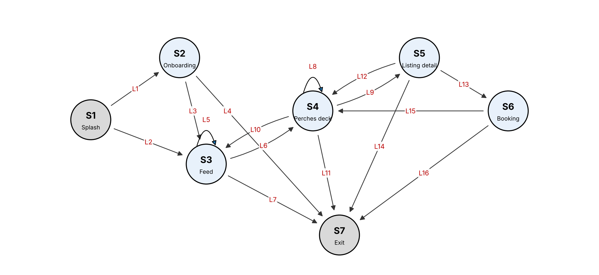

# Homework #3: FSM and Markov Operational Profile for Perch

Jayden Manyrath | CSE 5314, Fall 2026 | Prof. Jeff Tian | Homework #3 | November 3, 2026

## 1. FSM Model

I modeled Perch, the intern housing and social app from our course project, from a user's perspective. I focused on the housing flow: a user starts on the splash page, goes through onboarding or comes back as a returning user, browses the event feed, swipes through sublets on the Perches deck, opens a listing, and requests to book it. Each state is a screen and each link is a user action. Figure 1 shows the model, which has 7 states and 16 links, with S1 (Splash) as the start state and S7 (Exit) as the final state. It includes repetition. Opening more event comments (L5) and swiping to the next card (L8) are self-loops, and deck to listing and back (L9, L12) and deck to listing to booking and back (L9, L13, L15) are cycles that a user can repeat many times in one session.

## 2. Model Validation

I validated the first draft in two ways. First, a small script checked the model for dangling links, isolated and unreachable states, states with no way to reach Exit, and duplicate links. Second, I walked through the running app screen by screen to find missing states and links. Table 1 lists what I found and fixed. After the fixes, every state is reachable from Splash and can reach Exit, and there are no dangling or duplicate links.

| Problem in the first draft | Type | Fix |
| --- | --- | --- |
| "Close sheet" from Booking had no destination | Dangling link | Points to Perches deck (L15) |
| Booking had no way to Exit | Trap state | Added L16 |
| Deck to listing appeared twice ("tap card" and "tap Details") | Duplicate link | Merged into L9 |
| Returning users skip onboarding | Missing link | Added L2 |
| The Feed tab is also on the Perches deck | Missing link | Added L10 |
| Users can leave from a listing | Missing link | Added L14 |

Table 1. Problems found during validation.

## 3. Other Representations

I drew the FSM first as a graph (Figure 1). Table 2 converts it to the tabular form and Table 3 to the matrix form, where each cell gives the link from the row state to the column state.

| Link | Current state | Input | Next state |
| --- | --- | --- | --- |
| L1 | S1 Splash | tap Start onboarding | S2 Onboarding |
| L2 | S1 Splash | returning user opens app | S3 Feed |
| L3 | S2 Onboarding | finish onboarding | S3 Feed |
| L4 | S2 Onboarding | abandon onboarding | S7 Exit |
| L5 | S3 Feed | open event comments | S3 Feed |
| L6 | S3 Feed | tap Perches tab | S4 Perches deck |
| L7 | S3 Feed | leave app | S7 Exit |
| L8 | S4 Perches deck | swipe to next card | S4 Perches deck |
| L9 | S4 Perches deck | tap Details | S5 Listing detail |
| L10 | S4 Perches deck | tap Feed tab | S3 Feed |
| L11 | S4 Perches deck | leave app | S7 Exit |
| L12 | S5 Listing detail | close sheet | S4 Perches deck |
| L13 | S5 Listing detail | tap Request to book | S6 Booking |
| L14 | S5 Listing detail | leave app | S7 Exit |
| L15 | S6 Booking | close sheet | S4 Perches deck |
| L16 | S6 Booking | leave app | S7 Exit |

Table 2. Tabular representation.

| From \ To | S1 | S2 | S3 | S4 | S5 | S6 | S7 |
| --- | --- | --- | --- | --- | --- | --- | --- |
| S1 |  | L1 | L2 |  |  |  |  |
| S2 |  |  | L3 |  |  |  | L4 |
| S3 |  |  | L5 | L6 |  |  | L7 |
| S4 |  |  | L10 | L8 | L9 |  | L11 |
| S5 |  |  |  | L12 |  | L13 | L14 |
| S6 |  |  |  | L15 |  |  | L16 |
| S7 |  |  |  |  |  |  |  |

Table 3. Matrix representation.

## 4. Test Cases for Node and Link Coverage

Each test case is a path from S1 to S7, and the expected result is that every step reaches the next screen without an error. One test case covers every node, and five test cases cover all 16 links (Table 4). I ran all six on the app and they passed.

| Test | Coverage | Path | Links covered |
| --- | --- | --- | --- |
| N1 | Node | S1 > S2 > S3 > S4 > S5 > S6 > S7 | 1, 3, 6, 9, 13, 16 |
| K1 | Link | S1 > S2 > S3 > S3 > S4 > S4 > S3 > S4 > S5 > S4 > S5 > S6 > S4 > S7 | 1, 3, 5, 6, 8, 10, 6, 9, 12, 9, 13, 15, 11 |
| K2 | Link | S1 > S3 > S7 | 2, 7 |
| K3 | Link | S1 > S2 > S7 | 1, 4 |
| K4 | Link | S1 > S3 > S4 > S5 > S7 | 2, 6, 9, 14 |
| K5 | Link | S1 > S3 > S4 > S5 > S6 > S7 | 2, 6, 9, 13, 16 |

Table 4. Test cases for node coverage (N1) and link coverage (K1-K5).

## 5. Markov Operational Profile

**Data collection.** The best data source for Perch would be navigation logs from real users, either page views recorded by the app or the web server's access logs, grouped into sessions. The probability of a link is the number of times it was taken divided by the number of times users left its source state. Perch does not have real users yet, so I used two subsets of data.

The real data comes from eight team walkthrough sessions, based on the app's documented walkthrough and our earlier test runs. Each one was performed on the running app while recording every screen change, which gave 44 transitions. These sessions came from the team, so they miss some kinds of users, and two links (L10 and L16) were never taken at all.

The imputed data fills these gaps. Data imputation means filling in missing data with values that are reasonable given what is already known, not random guesses. I made up five sessions for user types the walkthroughs did not represent (Table 5). Each one only reuses steps that appear in the real sessions, and together they cover both missing links. They add 20 transitions. Table 6 keeps the real and imputed counts in separate columns, and each probability is (real + imputed) divided by the total for that state.

| Imputed session | User type | Path |
| --- | --- | --- |
| I1 | Returning user who only checks events | S1 > S3 > S3 > S7 |
| I2 | Browses sublets, then goes back to events | S1 > S3 > S4 > S4 > S3 > S7 |
| I3 | Sends a booking request and leaves | S1 > S3 > S4 > S5 > S6 > S7 |
| I4 | New user who gives up during onboarding | S1 > S2 > S7 |
| I5 | Window shopper who swipes and leaves | S1 > S3 > S4 > S4 > S4 > S7 |

Table 5. Imputed sessions.

| Link | From | To | Real | Imputed | Probability |
| --- | --- | --- | --- | --- | --- |
| L1 | Splash | Onboarding | 3 | 1 | 0.308 |
| L2 | Splash | Feed | 5 | 4 | 0.692 |
| L3 | Onboarding | Feed | 2 |  | 0.500 |
| L4 | Onboarding | Exit | 1 | 1 | 0.500 |
| L5 | Feed | Feed | 3 | 1 | 0.250 |
| L6 | Feed | Perches deck | 6 | 3 | 0.562 |
| L7 | Feed | Exit | 1 | 2 | 0.188 |
| L8 | Perches deck | Perches deck | 3 | 3 | 0.300 |
| L9 | Perches deck | Listing detail | 6 | 1 | 0.350 |
| L10 | Perches deck | Feed | 0 | 1 | 0.050 |
| L11 | Perches deck | Exit | 5 | 1 | 0.300 |
| L12 | Listing detail | Perches deck | 2 |  | 0.286 |
| L13 | Listing detail | Booking | 3 | 1 | 0.571 |
| L14 | Listing detail | Exit | 1 |  | 0.143 |
| L15 | Booking | Perches deck | 3 |  | 0.750 |
| L16 | Booking | Exit | 0 | 1 | 0.250 |

Table 6. Markov-OP for Perch.

Usage-based test cases are random walks from S1 that follow these probabilities until they reach Exit.

**Karami-Tian method.** Karami and Tian's method keeps a Markov-OP up to date when a web application changes, before any usage data for the new version exists. It compares the old Markov-OP with the activity diagrams of the new version and adds or removes the states and links that changed. It then estimates the new probabilities from partial usage data, from a similar existing model, or by spreading the probability across the links. It cannot be used to build my first Markov-OP, because it needs an existing one to start from. It can be used to update it later, because Perch changes often. For example, if the Negotiate screen becomes part of the main flow, I could add it as a new state and give it a share of the Perches deck's probability until real data is available.

**Comparison with Musa-OP.** A Musa-OP is a flat list of operations and their probabilities, with no order. A Markov-OP gives the probability of the next action based on the current screen, so it captures sequences such as deck to listing to booking. To convert the Markov-OP into a Musa-OP, I counted how many times each screen appears across all the sessions (real and imputed) and divided by the total (Table 7). The conversion keeps how often each screen is used but loses the order. For example, Booking is 7.8% of screen visits, but the Musa-OP no longer shows that Booking can only follow Listing detail.

| Operation (screen) | Visits in all sessions | Musa-OP probability |
| --- | --- | --- |
| S4 Perches deck | 20 | 0.392 |
| S3 Feed | 16 | 0.314 |
| S5 Listing detail | 7 | 0.137 |
| S2 Onboarding | 4 | 0.078 |
| S6 Booking | 4 | 0.078 |

Table 7. Musa-OP converted from the Markov-OP.
